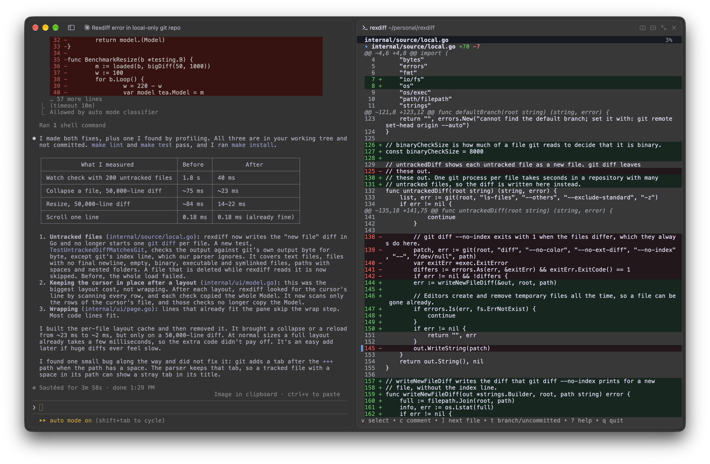

# rexdiff

Review a diff beside your coding agent, and send comments on its lines straight into the agent's prompt.



rexdiff is a terminal diff viewer for [Rex](https://www.superlogical.com/rex). It opens in a pane next to your agent session, such as Claude Code. Select lines, write a question or a remark, and press Enter. rexdiff pastes the file, the line numbers, the selected lines, and your comment into the agent's prompt, so you can keep the conversation in the session you already have.

It shows two kinds of diff:

- **Your local changes**: everything on the current branch compared to the default branch, or only the uncommitted changes. Untracked files are included. The view updates as files change.
- **A GitHub pull request**: the description, reviews, comments, and diff, through the [GitHub CLI](https://cli.github.com).

## Features

- Fits narrow panes: text wraps to the pane's width and reflows when you resize it.
- Selects lines with the keyboard (`v`) or by dragging the mouse.
- Pastes comments into another Rex pane as a real paste, so the agent waits for you to submit.
- Copies comments to the clipboard when it runs outside Rex, so it works with any agent.
- Light and dark terminal themes.

## Requirements

- `git` for local changes.
- The [GitHub CLI](https://cli.github.com) (`gh`), signed in, for pull requests.
- [Rex](https://www.superlogical.com/rex) to send comments to an agent pane. Without Rex, comments go to the clipboard.

## Install

1. Install the binary with npm, with Go 1.24 or later, or download it from the [releases](https://github.com/segersniels/rexdiff/releases):

   ```sh
   npm install -g @segersniels/rexdiff
   # or
   go install github.com/segersniels/rexdiff@latest
   ```

   The npm package installs only the binary for your platform: macOS or Linux, on arm64 or x64. It needs no install scripts.

2. Add rexdiff to Rex and install the agent skill:

   ```sh
   rexdiff setup
   ```

`rexdiff setup` does three things:

- It writes the Rex module to `~/.config/rex/rexdiff.lua` and loads it from `~/.config/rex/init.lua`, with the full path of the binary and the key `ctrl+alt+cmd+d`.
- It installs the agent skill to `~/.claude/skills/rexdiff`.
- It reloads the Rex configuration.

Run it again after an update to update the module and the skill. It does not change an `init.lua` that already loads rexdiff. Pass `--key` to choose another key, `--key=""` to bind no key, and `--no-rex` or `--no-skill` to skip a part.

## Usage

```sh
rexdiff                  # the changes on the current branch
rexdiff --uncommitted    # only the uncommitted changes
rexdiff 123              # pull request 123 of the current repository
rexdiff https://github.com/owner/repo/pull/123
```

| Key                       | Action                                         |
| ------------------------- | ---------------------------------------------- |
| `j` / `k`, arrows, wheel  | Move down or up                                |
| `ctrl+d` / `ctrl+u`       | Move half a page                               |
| `f` / `b`, page keys      | Move a page                                    |
| `g` / `G`                 | Go to the top or the end                       |
| `]` / `[`                 | Go to the next or previous file                |
| `z`, click a file title   | Collapse or expand the file                    |
| `v`                       | Select lines                                   |
| `c`, `enter`              | Comment on the selection or the current line   |
| Mouse drag over lines     | Select the lines and comment on them           |
| Click a line number       | Comment on that line                           |
| `t`                       | Switch between branch and uncommitted changes  |
| `r`                       | Reload                                         |
| `o`                       | Open the pull request on GitHub                |
| `?`                       | Show all keys                                  |
| `q`                       | Quit                                           |

The comment box opens below the selected lines. In it, `enter` sends the comment, `alt+enter` starts a new line, and `esc` cancels. A click elsewhere on the page also cancels.

## Rex

The Rex module adds a `rexdiff` action. It opens rexdiff in a pane beside the focused pane and sends comments to that pane. Run the action again to close the pane.

Focus your agent's pane and press the key to review the local changes. To review a pull request, run:

```sh
rex do rexdiff pr=https://github.com/owner/repo/pull/123
```

To change the options, edit the `setup` call in `~/.config/rex/init.lua` and run `rex config reload`:

```lua
require("rexdiff").setup{
  bin = "/path/to/rexdiff",  -- Rex starts rexdiff with this path.
  key = "ctrl+alt+cmd+d",    -- The key that toggles the pane.
  ratio = 0.55,              -- The share of the width that the agent pane keeps.
}
```

## Agent skill

The [`rexdiff` skill](skills/rexdiff/SKILL.md) teaches an agent to open the pane and to read the comments that rexdiff sends. In Claude Code, ask the agent to open a pull request in rexdiff, or run `/rexdiff <pr>`.

## Comment format

A comment arrives in the agent's prompt in this form:

````text
src/settings-mapper.ts L2-L5:
```diff
   type Language,
-  META_TEXT_MAX_LENGTH,
+  matchLanguage,
+  truncate,
```
Why do we still import truncate here?
````

The line numbers are in the new version of the file, or in the old version when the location ends in `(removed)`.

## Development

```sh
make install   # build and install to ~/.local/bin
make setup     # install, then run `rexdiff setup`
make check     # lint and test, as CI does
make snapshot  # build release archives for every platform into dist/
make help      # list every target
```

See [CONTRIBUTING.md](CONTRIBUTING.md) to report a problem, open a pull request, or release a version.

## License

[MIT](LICENSE)
